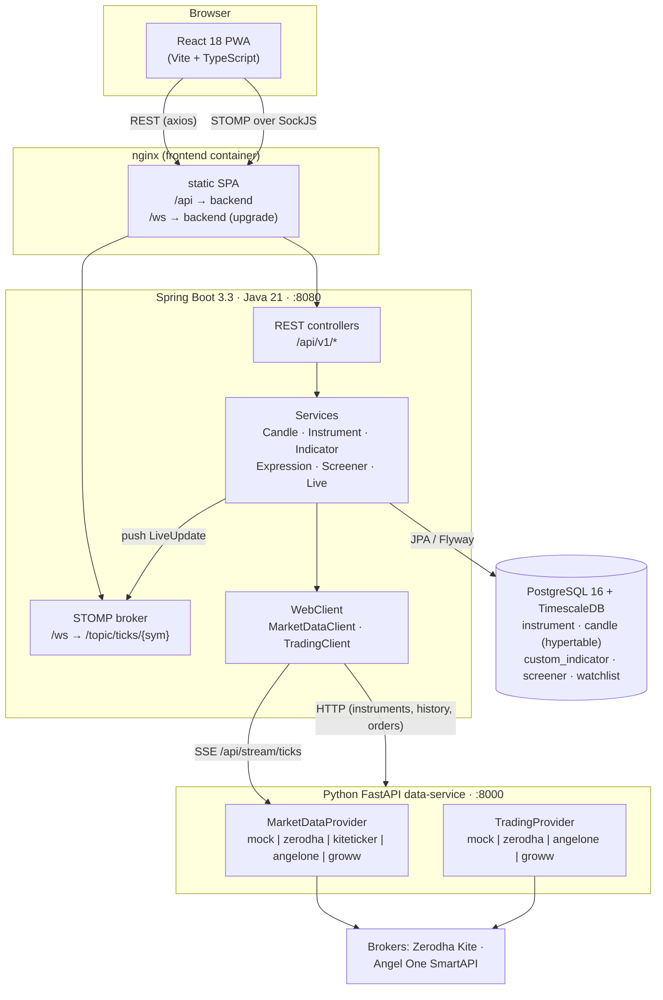
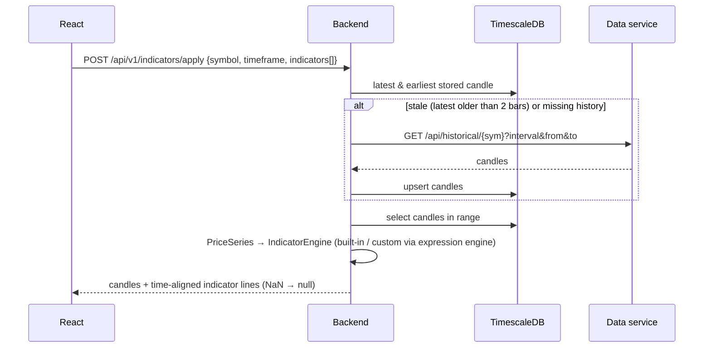
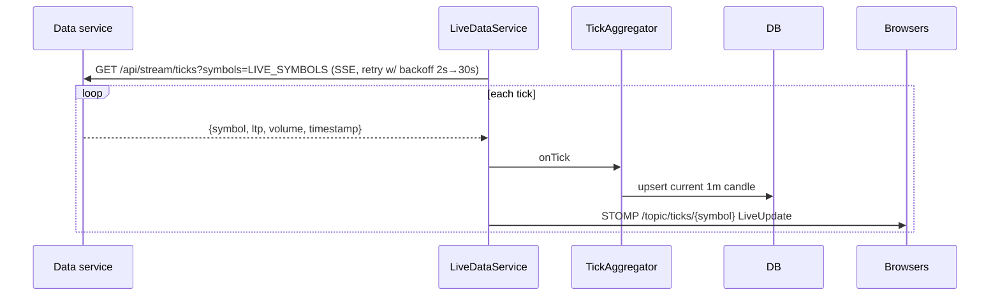

# StockCharts — Features & Architecture

This document describes what StockCharts does and how it is built. It was written from the
current source, so it also covers parts the older docs do not: the trading module, the
Angel One and Groww integrations, and bar replay. For endpoint-by-endpoint detail see
[`DOCUMENTATION.md`](DOCUMENTATION.md); for quick start see [`README.md`](README.md).

---

## 1. What the application is

StockCharts is a self-hosted web app for **technical charting, screening and trading of NSE
(National Stock Exchange of India) stocks**. It combines:

- a TradingView-style candlestick chart with built-in and user-defined indicators,
- a multi-stock screener driven by a small formula language,
- a trading panel (orders, positions, holdings, funds) that talks to a real broker or a
  paper-trading simulator,
- a bar-by-bar **replay** mode for manual backtesting.

With no configuration, it runs on **synthetic market data** and a **paper-trading broker**,
so the whole stack works without credentials. You switch to real data or a real broker
through configuration, or at runtime from the UI.

---

## 2. Feature catalogue

### 2.1 Charting
| Feature | Details | Where |
|---|---|---|
| Symbol search | Async dropdown over the synced instrument table (symbol or name) | `StockSearch.tsx` → `GET /instruments` |
| Candlestick + volume | `lightweight-charts`; volume histogram overlaid at the bottom of the main pane | `Chart.tsx` |
| Timeframes | `1m, 5m, 15m, 30m, 1h, 1d` | `TimeframeBar.tsx`, `Timeframe.java` |
| Overlay indicators | Drawn on the price pane (SMA, EMA, WMA, BBANDS, VWAP, overlay customs) | `Chart.tsx` |
| Oscillator pane | Non-overlay indicators (RSI, MACD, STOCH, ATR, ADX, OBV, CCI) in a second chart with a synced time scale | `Chart.tsx` |
| Live updates | STOMP subscription to `/topic/ticks/{symbol}` updates the last candle in place | `ws/stomp.ts`, `Chart.tsx` |
| Trade markers | Orders placed from the quick-trade panel show as buy/sell arrows on the chart | `App.tsx`, `TradingPanel.tsx` |

### 2.2 Indicators
- **12 built-ins**: `SMA, EMA, WMA, RSI, MACD, BBANDS, STOCH, ATR, ADX, OBV, VWAP, CCI`.
  Each has configurable parameters. The catalog, including parameter defaults, is served by
  `GET /indicators`.
- **Own TA library** (`com.stockcharts.ta.Indicators`): primitive `double[]` math with no
  external TA dependency. Despite what the README says, TA4J is not used.
- **Custom indicators**: named formulas such as `ema_spread = ema(close,9) - ema(close,21)`.
  They are stored in the DB and listed in the catalog next to the built-ins. A custom
  indicator can reference other custom indicators; circular references are detected.

### 2.3 Expression language (shared by custom indicators and screeners)
- **Price fields**: `open, high, low, close, volume, hl2, hlc3 (typical), ohlc4`
- **Functions**: `sma, ema, wma, rma, rsi, stdev, highest, lowest, change, abs, macd,
  bb_upper, bb_middle, bb_lower, atr, adx, cci, vwap, stoch_k, stoch_d, obv, crossover,
  crossunder, max, min`
- **Operators**: `+ - * / %`, comparisons `> >= < <= == !=`, logic `and or not`
- **Sandboxing**: a hand-written lexer, parser and evaluator (`com.stockcharts.expr`). Only
  whitelisted fields and functions are allowed; there is no reflection or scripting engine.
  Expressions are limited to 2000 characters and compiled ASTs are cached.
- **Validation**: each expression is test-evaluated on a synthetic 60-bar series. Unknown
  identifiers are rejected, which catches typos.

### 2.4 Screener
- A boolean expression is evaluated at the **latest bar** of every symbol in a universe.
  Matches are returned with extra user-defined columns, such as the RSI value.
- **Universes**: `index` (built-in NIFTY-50 list), `list` (comma-separated), `watchlist`
  (saved), or `all` (every synced instrument).
- **Parallel evaluation**: runs on a dedicated `ForkJoinPool`. Scans are bounded by
  `max-universe` (500), `parallelism` (8) and `result-limit` (200).
- **Saved screeners** and **watchlists**: full CRUD, persisted in Postgres.
- **Guided condition builder** (`ConditionBuilder.tsx`): the user picks metric, operator and
  value rows joined with AND/OR. The builder generates an expression that can be edited
  directly in advanced mode. Clicking a result opens that symbol's chart.

### 2.5 Trading
- **Order ticket**: MARKET, LIMIT, SL and SL-M order types; BUY or SELL; product types
  CNC, MIS and NRML.
- **Tabs** for Orders (with cancel), Positions (net/day), Holdings and Funds.
- **Quick-trade side panel** on the chart view. In replay mode it pre-fills the current bar's
  close and tags the order `replay`.
- **Brokers** (switchable at runtime from the *broker* button):

| Broker | Status | Credentials |
|---|---|---|
| `mock` (default) | In-memory paper trading with ₹10 lakh virtual cash. MARKET orders fill at a seed price; LIMIT orders fill if the price is within 1% of it, otherwise they stay OPEN. | none |
| `zerodha` | Real orders via Kite Connect | `api_key` + daily `access_token` |
| `angelone` | Real orders via SmartAPI | `api_key`, `client_id`, TOTP secret |
| `groww` | Stub that raises `NotImplementedError` (Groww has no public API) | — |

### 2.6 Market-data sources (switchable at runtime from the *source* button)
| Provider | Historical | Live |
|---|---|---|
| `mock` (default) | Deterministic random walk per symbol and interval, over about 50 NSE stocks | Synthetic ticks every `TICK_INTERVAL_SECONDS` |
| `zerodha` | PyZData with an **enctoken** (no paid API). Sync calls run in worker threads. | Polls the latest 1m candle every `ZERODHA_POLL_SECONDS` |
| `kiteticker` | Delegates to `zerodha` | Stub: a real KiteTicker websocket is not wired yet |
| `angelone` | SmartAPI candles | Polling the latest 1m candle |
| `groww` | Falls back to mock | Falls back to mock |

Switching the source re-syncs the instrument table and restarts the backend's live stream.

### 2.7 Bar replay
The **⏵ Replay** control hides future bars and reveals them one at a time. You can step
±1, scrub, or auto-play at 1, 2, 5 or 10 bars per second. Indicator lines and trade markers
are cut off at the replay position. Replay is entirely client-side: the full dataset is
already loaded and `Chart` only renders the first *N* bars.

### 2.8 PWA and mobile
The app uses `vite-plugin-pwa` for its manifest, service worker (auto-update) and icons, with
a mobile-first layout. It can be installed with "Add to Home Screen". The dev server binds to
`0.0.0.0`, and SockJS provides a fallback for restrictive mobile networks.

---

## 3. Architecture

### 3.1 System overview



**Main design rule:** everything specific to a broker or provider lives in the Python service,
behind two abstract interfaces (`MarketDataProvider` and `TradingProvider`). The Java backend
does not know which provider is active. It owns the domain API, indicator math, expression
engine, screener, persistence and the client-facing WebSocket. The browser talks only to the
backend, never to the data service.

### 3.2 Components

| Tier | Tech | Responsibility |
|---|---|---|
| **Frontend** (`frontend/`) | React 18, TS, Vite, lightweight-charts, react-select, @stomp/stompjs + SockJS, axios, vite-plugin-pwa; served by nginx | UI; three views (Chart / Screener / Trade) and modals for custom indicators, data source and broker |
| **Backend** (`backend/`) | Spring Boot 3.3 (web + webflux WebClient + websocket + JPA + validation + actuator), Flyway, springdoc-openapi | `/api/v1` REST, STOMP push, candle cache/backfill, tick aggregation, indicators, expressions, screener, trading proxy |
| **Data service** (`data-service/`) | Python 3.12, FastAPI, pydantic-settings, optional PyZData / kiteconnect / smartapi-python | Pluggable market data (REST + SSE) and pluggable trading; runtime hot-swap |
| **Database** | PostgreSQL 16 + TimescaleDB 2.17 | Instruments, OHLCV candles (hypertable if the extension exists), user objects |
| **Infra** | Docker (multi-stage), docker-compose, Kubernetes/Kustomize (base + dev/prod overlays), Makefile | Build and deploy |

### 3.3 Backend package map (`com.stockcharts.*`)

| Package | Key classes | Role |
|---|---|---|
| `instrument` | `InstrumentService`, `InstrumentController` | Sync the universe from the data service on startup and every 6h; search |
| `candle` | `CandleService`, `Candle`, `Timeframe` | Read-through candle cache with backfill |
| `marketdata` | `MarketDataClient`, `DataSourceController` | WebClient to the data service; switch provider |
| `live` | `LiveDataService`, `TickAggregator`, `LiveUpdate` | SSE → 1m bars → STOMP broadcast |
| `ta` | `Indicators`, `PriceSeries` | Primitive-array TA library |
| `indicator` | `IndicatorEngine`, `IndicatorType`, `CustomIndicatorService` | Built-in plus custom indicator computation; catalog; custom CRUD |
| `expr` | `Lexer`, `Parser`, `Expr` (sealed AST), `Evaluator`, `ExpressionService` | Sandboxed formula language |
| `screener` | `ScreenerService`, `Screener`, `Watchlist` | Universe resolution, parallel scan, saved screeners and watchlists |
| `trading` | `TradingController`, `TradingClient`, DTOs | Thin proxy to the data-service trading API |
| `config` | `WebSocketConfig`, `CorsConfig`, `WebClientConfig`, `ApiExceptionHandler`, `AppProperties` | Cross-cutting configuration and error mapping (400 / 404) |

### 3.4 Data service layout (`data-service/app/`)

```
main.py            FastAPI app, lifespan, runtime swap of provider/broker, all routes
config.py          pydantic-settings (env / .env)
models.py          Instrument, Candle, Tick
providers/         base.py (ABC) + mock, zerodha, kiteticker, angelone, groww, nse_universe
trading/           base.py (ABC) + models.py + mock, zerodha, angelone, groww
```
Both factories (`build_provider` and `build_trading_provider`) **import lazily**, so optional
broker SDKs are only needed when that provider is selected. The Dockerfile installs them
through build args (`ZERODHA`, `ZERODHA_TRADE`, `ANGELONE`).

### 3.5 Database schema (Flyway `V1`–`V3`)

| Table | Key | Notes |
|---|---|---|
| `instrument` | `symbol` | name, instrument_token, exchange |
| `candle` | `(symbol, timeframe, open_time)` | OHLCV as `DOUBLE PRECISION`; converted to a TimescaleDB hypertable when available, otherwise a plain table |
| `custom_indicator` | `name` | expression, overlay flag, description |
| `watchlist` | `name` | comma-separated symbols |
| `screener` | `name` | expression, universe type/value, timeframe |

The `dev` Spring profile swaps in in-memory H2 with `ddl-auto=create-drop` and Flyway turned
off, so the backend can run without Postgres.

---

## 4. Key runtime flows

### 4.1 Loading a chart (read-through cache)


The default range is `BACKFILL_DAYS` (5) for intraday timeframes and 365 days for `1d`.

### 4.2 Live ticks


Only symbols listed in `stockcharts.live-symbols` are streamed (by default `RELIANCE, TCS,
HDFCBANK, INFY, ICICIBANK`). Other symbols show history but do not tick. Ticks are aggregated
only into **1-minute** candles; higher timeframes pick up new data through the backfill check.

### 4.3 Screener run
`POST /screener/run` → validate and compile the expression → resolve the universe (filtered to
known instruments and capped at `max-universe`) → in parallel, for each symbol: load candles
(backfilling if needed) → compute any referenced custom indicators → evaluate → keep the
symbol if the last value is above 0.5 → evaluate the extra columns → sort by symbol and apply
the limit.

### 4.4 Trading and switching source or broker
`TradingController` → `TradingClient` (WebClient) → `data-service /api/trading/*` → active
`TradingProvider`. `POST /datasource` and `POST /broker` forward to the data service, which
builds the new provider, swaps the global reference and closes the old one. On a data-source
switch, the backend also re-syncs instruments and restarts the live stream.

---

## 5. API surface (backend, base `/api/v1`)

| Area | Endpoints |
|---|---|
| Instruments | `GET /instruments?query=` |
| Candles | `GET /candles/{symbol}?timeframe=&from=&to=` |
| Indicators | `GET /indicators`, `POST /indicators/apply` |
| Custom indicators | `GET/POST /custom-indicators`, `PUT/DELETE /custom-indicators/{name}`, `POST /custom-indicators/validate` |
| Screener | `POST /screener/run`, `GET/POST /screener`, `DELETE /screener/{name}`, `POST /screener/{name}/run` |
| Watchlists | `GET/POST /watchlists`, `GET/DELETE /watchlists/{name}` |
| Data source | `GET/POST /datasource` |
| Trading | `GET/POST /broker`, `GET/POST /trading/orders`, `PUT/DELETE /trading/orders/{id}`, `GET /trading/positions`, `GET /trading/holdings`, `GET /trading/funds` |
| WebSocket | `/ws` (STOMP, with SockJS and raw WebSocket) → subscribe `/topic/ticks/{SYMBOL}` |
| Docs / ops | `/swagger-ui.html`, `/actuator/health` |

Data-service internal API: `/health`, `/api/provider`, `/api/instruments`,
`/api/historical/{symbol}`, `/api/stream/ticks` (SSE), `/api/broker`, `/api/trading/*`.

---

## 6. Configuration

| Setting | Where | Default |
|---|---|---|
| `MARKET_DATA_PROVIDER` | data-service | `mock` |
| `ENCTOKEN` | data-service | — (needed for `zerodha` / `kiteticker`) |
| `TRADING_BROKER` | data-service | `mock` |
| `ZERODHA_API_KEY`, `ZERODHA_ACCESS_TOKEN` | data-service | — |
| `ANGELONE_API_KEY`, `ANGELONE_CLIENT_ID`, `ANGELONE_TOTP_SECRET` | data-service | — |
| `TICK_INTERVAL_SECONDS`, `ZERODHA_POLL_SECONDS` | data-service | `1.0`, `5.0` |
| `DATA_SERVICE_URL` | backend | `http://localhost:8000` |
| `LIVE_SYMBOLS` | backend | `RELIANCE,TCS,HDFCBANK,INFY,ICICIBANK` |
| `BACKFILL_DAYS` | backend | `5` |
| `stockcharts.screener.{max-universe,parallelism,result-limit}` | backend | `500, 8, 200` |
| `POSTGRES_*` | backend | `stockcharts` / `localhost:5432` |
| `VITE_API_TARGET` | frontend dev proxy | `http://localhost:8080` |

---

## 7. Deployment

- **docker-compose**: `timescaledb` (host port 5433), `data-service` (8000), `backend` (8080)
  and `frontend` (nginx, host port **3000**). The README says 8088, but the compose file maps
  3000. Makefile shortcuts: `make up`, `up-zerodha`, `up-zerodha-trade`, `up-angelone`,
  `down`, `logs`, `test`.
- **Kubernetes** (`k8s/`): the Kustomize base has a Namespace, ConfigMaps and Secrets, a
  TimescaleDB StatefulSet, Deployments and Services for the three apps, and an Ingress at
  `stockcharts.local` (`/api` and `/ws` → backend, `/` → frontend). The `dev` overlay uses
  mock data. The `prod` overlay patches the config to `zerodha` data and broker and injects
  gitignored secret files (`enctoken.secret.yaml`, `broker.secret.yaml`).
- **Tests**: backend JUnit tests (`IndicatorEngineTest`, `ExpressionServiceTest`, and a
  `BackendIntegrationTest` that loads the full Spring context on H2 with a mocked data
  service). The frontend check is `tsc --noEmit && vite build`.

---

## 8. Observations and known gaps

These come from reading the code. They are useful context for anyone extending the app.

1. **No authentication or authorization anywhere.** CORS and WebSocket origins are `*`, and
   the trading and broker-credential endpoints are open. Before any real-money broker is
   connected on a reachable host, the app needs auth, or at least network restrictions.
2. **Broker credentials** are sent in plain JSON through `POST /broker` and kept only in the
   data service's memory, so they are lost on restart.
3. **Global mutable provider state** in the data service (module-level `provider` and
   `trading_provider`) assumes a single replica. The backend's in-memory `TickAggregator`
   and simple STOMP broker make the same assumption, so none of the services scale
   horizontally as written.
4. **Live streaming is limited** to the configured `LIVE_SYMBOLS` and aggregates only into
   1m candles. Real-data "live" feeds are polling-based until KiteTicker or SmartWebSocket
   is implemented.
5. **The paper broker** fills at static seed prices, not live mock prices, and its state is
   in memory only.
6. **Doc drift**: the README mentions TA4J (not used) and frontend port 8088 (compose uses
   3000). Its project-structure section also leaves out the trading module.
7. **Groww** is a placeholder for both data and trading.
