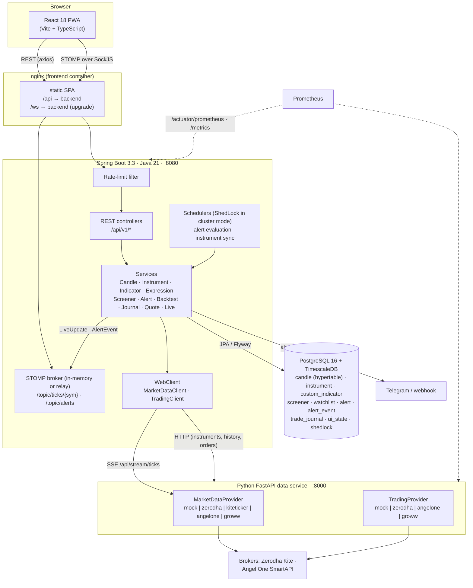
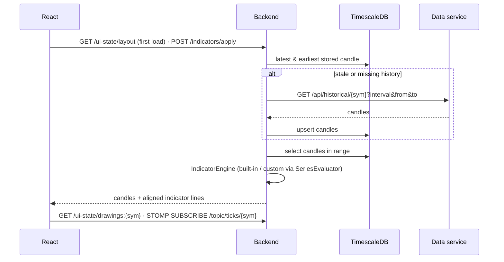
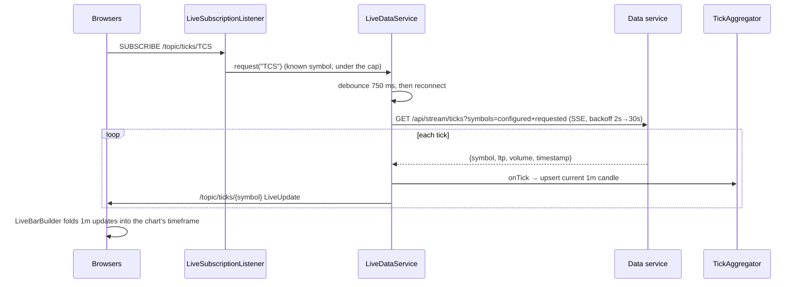

# StockCharts — Features & Architecture

This document describes what StockCharts does and how it is built, written from the current
source. For endpoint-by-endpoint detail see [`DOCUMENTATION.md`](DOCUMENTATION.md) (older, and
without the modules added since); for quick start and operations see [`README.md`](README.md).

---

## 1. What the application is

StockCharts is a self-hosted web app for **technical charting, screening, alerting, backtesting
and trading of Indian stocks** (NSE, plus NSE/BSE indices). It combines:

- a TradingView-style chart: several chart types, built-in and user-defined indicators,
  drawings, symbol comparison, live updates and bar replay,
- a **watchlist** with live prices and day change,
- a multi-stock **screener** driven by a small formula language, over index universes,
- **alerts** on price levels or any formula, delivered in-app, as browser notifications,
  to Telegram or to a webhook,
- a rule-based **backtester** that reuses the same formula language,
- a trading panel (orders, positions, holdings, funds) that talks to a real broker or a
  paper-trading simulator,
- a **trade journal** and **portfolio report**: realised P&L, estimated charges and a
  capital-gains tax estimate by financial year.

With no configuration, it runs on **synthetic market data** and a **paper-trading broker**,
so the whole stack works without credentials. You switch to real data or a real broker
through configuration, or at runtime from the UI.

---

## 2. Feature catalogue

### 2.1 Charting
| Feature | Details | Where |
|---|---|---|
| Symbol search | Async dropdown over the synced instrument table; indices and non-NSE listings are tagged | `StockSearch.tsx` → `GET /instruments` |
| Chart types | Candles, Heikin-Ashi, OHLC bars, line, area; volume histogram underneath | `Chart.tsx`, `lib/chartMath.ts` |
| Timeframes | `1m, 5m, 15m, 30m, 1h, 1d` | `TimeframeBar.tsx`, `Timeframe.java` |
| Overlay indicators | Price pane: SMA, EMA, WMA, BBANDS, VWAP, overlay customs | `Chart.tsx` |
| Oscillator pane | RSI, MACD, STOCH, ATR, ADX, OBV, CCI in a second chart with a synced time scale | `Chart.tsx` |
| Live updates | STOMP `/topic/ticks/{symbol}`; `LiveBarBuilder` updates the current bar and starts a new one at each bucket boundary on **every** timeframe | `ws/stomp.ts`, `lib/chartMath.ts` |
| Compare | Overlay a second symbol; both series switch to a percentage scale | `ChartToolbar.tsx`, `Chart.tsx` |
| Drawings | Horizontal level (1 click), trend line and Fibonacci retracement (2 clicks); saved per symbol, undo/clear | `Chart.tsx`, `/ui-state/drawings:{symbol}` |
| More history | Fetches 500 older bars per click | `App.tsx` |
| Saved layout | Symbol, timeframe, indicators, chart type and watchlist restored on load | `/ui-state/layout` |
| Trade markers | Buy/sell arrows for orders placed from the quick-trade panel or for backtest trades | `App.tsx`, `TradingPanel.tsx`, `BacktestView.tsx` |

### 2.2 Indicators
- **12 built-ins**: `SMA, EMA, WMA, RSI, MACD, BBANDS, STOCH, ATR, ADX, OBV, VWAP, CCI`,
  with parameters. The catalog is served by `GET /indicators`.
- **Own TA library** (`com.stockcharts.ta.Indicators`): primitive `double[]` math, no
  external TA dependency.
- **Custom indicators**: named formulas such as `ema_spread = ema(close,9) - ema(close,21)`,
  stored in the DB and listed with the built-ins. They can reference each other; cycles are
  rejected.

### 2.3 Expression language (custom indicators, screeners, alerts, backtests)
- **Price fields**: `open, high, low, close, volume, hl2, hlc3 (typical), ohlc4`
- **Functions**: `sma, ema, wma, rma, rsi, stdev, highest, lowest, change, abs, macd,
  bb_upper, bb_middle, bb_lower, atr, adx, cci, vwap, stoch_k, stoch_d, obv, crossover,
  crossunder, max, min`
- **Operators**: `+ - * / %`, comparisons `> >= < <= == !=`, logic `and or not`
- **Sandboxing**: hand-written lexer, parser and evaluator (`com.stockcharts.expr`); only
  whitelisted fields and functions; 2000-character limit; compiled ASTs cached.
- **Validation**: test-evaluated on a synthetic series; unknown identifiers rejected.
  `SeriesEvaluator` is the shared entry point that also resolves custom-indicator references.

### 2.4 Screener
- A boolean expression evaluated at the **latest bar** of every symbol in a universe, with
  extra display columns.
- **Universes**: `index` with a code (`NIFTY50` default, `BANKNIFTY`, `NIFTYIT`, `NIFTYAUTO`,
  `NIFTYPHARMA`, `NIFTYFMCG` — `GET /screener/universes`), `list`, `watchlist`, or `all`
  (every equity; indices excluded).
- Parallel evaluation on a dedicated `ForkJoinPool`, bounded by `max-universe` (500),
  `parallelism` (8) and `result-limit` (200). Saved screeners and watchlists; guided
  condition builder in the UI.

### 2.5 Watchlist panel
- Pick or create a watchlist, add symbols (equities or indices), remove them, click to open.
- Last price and day change from `GET /quotes` (polled every 10 s, cached 2 s server-side),
  moved between polls by live ticks.
- Subscribing to a symbol's ticks makes the backend stream it (see 4.2), so watchlist symbols
  are live rather than only the five configured ones.

### 2.6 Alerts
- Condition = expression on one symbol/timeframe. UI templates: price crosses above/below,
  is above/below (`crossover(close, 3000)`, `close > 3000`, …) or any custom expression.
- **Trigger modes**: `ONCE` (then `TRIGGERED`, can be re-armed) or `EVERY_BAR` (at most once
  per bar while true). Alerts can be paused; one whose expression stops working (e.g. a deleted
  custom indicator) is paused automatically.
- Evaluated every 15 s (`stockcharts.alerts.interval`) by `AlertService`, grouped by
  (symbol, timeframe) so each series loads once. Fires are stored in `alert_event`.
- **Delivery** (`AlertNotifier`): STOMP `/topic/alerts` → Alerts page and in-app toast, plus a
  browser notification when permitted and the tab is hidden; optional Telegram bot and
  generic JSON webhook (fire-and-forget, so slow endpoints never stall evaluation).

### 2.7 Backtester
- Inputs: symbol, timeframe, date range (defaults: 3y for 1d, 180d for 1h, 10d for 1m, 30d
  otherwise), entry and optional exit expressions, long or short, stop-loss % and take-profit %,
  capital, position size % of equity (no leverage), commission and slippage per leg.
- **Execution model** (`BacktestEngine`, pure and unit-tested): signals read at a bar's close
  fill at the next bar's open (no look-ahead); stops/targets checked against each bar's
  high/low, stop first if both are touched, gaps filled at the open; a position still open at
  the end is closed at the last close.
- Output: net profit, return vs buy-and-hold, trades, win rate, average win/loss, profit factor,
  max drawdown, annualised Sharpe (NSE session length), exposure, average holding period,
  costs; equity + drawdown curve (thinned to 2,000 points); trade list; "show trades on chart".
- **Latest-bar signal**: every result also reports the strategy's state at the last bar — `ENTRY`
  (condition true while flat → act at the next open), `EXIT`, `IN_POSITION` (with open P&L) or `NONE`.
- **Scanner** (`POST /backtest/scan`): one strategy over a universe (resolved by the shared
  `UniverseService`, same rules as the screener) in a bounded parallel pool. Candles go through the
  read-through cache, so stale ranges are re-fetched and each scan includes the latest bar; the
  response reports the newest bar time. Rows are ranked by return, net profit, win rate, profit
  factor, Sharpe, drawdown or trade count, and filtered by minimum trades / win rate / profit factor
  or "actionable signal only". The UI can re-run it every 5/15/60 minutes.

### 2.8 Trading
- **Order ticket**: MARKET, LIMIT, SL, SL-M; BUY/SELL; CNC, MIS, NRML. Tabs for Orders (with
  cancel), Positions, Holdings, Funds. Quick-trade side panel on the chart (pre-filled in replay).
- **Brokers** (runtime switch):

| Broker | Status | Credentials |
|---|---|---|
| `mock` (default) | In-memory paper trading, ₹10 lakh virtual cash. MARKET orders fill at a fixed seed price; LIMIT orders within 1% of it fill, others stay OPEN. | none |
| `zerodha` | Real orders via Kite Connect | `api_key` + daily `access_token` |
| `angelone` | Real orders via SmartAPI | `api_key`, `client_id`, TOTP secret |
| `groww` | Stub (no public Groww API) | — |

- **Safeguards** (`risk` package, enforced server-side): per-order quantity/value limits, orders
  per day, a daily loss limit on realised + open P&L, and a kill switch that cancels open orders.
  Position-reducing orders are always allowed. Live-broker orders need a preview, then a signed,
  single-use 60 s confirmation token bound to the exact order (`X-Order-Confirmation`; 428
  without it). Limit breaches return 422 with the reasons and count in
  `stockcharts_orders_rejected_total`.

### 2.9 Trade journal & portfolio report
- **Journal**: every order placed through the app that comes back `COMPLETE` is recorded
  (`source=APP`); "Import from broker" pulls completed orders from the broker's order book
  (`SYNC`, idempotent per broker order id); trades can also be typed in (`MANUAL`). Each fill can
  carry a strategy label and notes.
- **Report** (`PortfolioReport`, pure and unit-tested): FIFO lot matching per symbol (longs and
  shorts). Each closed lot is **INTRADAY** (same IST day or MIS), **LTCG** (long lot held more than
  12 months) or **STCG**. Estimated charges per leg (discount-broker brokerage, STT, NSE
  transaction charge, SEBI fee, stamp duty, GST). Summaries by category, symbol and IST day
  (cumulative P&L chart), open lots, and per **financial year** a tax estimate: STCG 20%, LTCG
  12.5% above ₹1.25 lakh, plus 4% cess, with short-term losses set off against long-term gains.
  All assumptions are returned with the report; CSV export for spreadsheets or a CA.

### 2.10 Market data
| Provider | Historical | Live |
|---|---|---|
| `mock` (default) | ~75 NSE stocks + 8 NSE/BSE indices. Price is a deterministic function of time, so every timeframe agrees and restarts reproduce the same data | Ticks sample the same curve (24/7) |
| `kiteticker` (Zerodha Kite Connect) | `historical_data` in ≤ Kite-limit windows (60 d for 1m … 2000 d for 1d), paced < 3 req/s, IST | KiteTicker websocket (FULL mode), day volume |
| `angelone` (SmartAPI) | Instrument master for symbol↔token; `getCandleData` in ≤ SmartAPI-limit windows (30 d for 1m …), IST; auto re-login daily and on token errors | SmartWebSocket V2 (QUOTE mode; paise → rupees), day volume |
| `zerodha` (enctoken) | PyZData (its own windowing and pacing); naive-IST timestamps converted | Polls the latest 1m bar and sends the whole bar |
| `groww` | Mock fallback | Mock fallback |

Real-broker feeds are supervised by `BrokerFeed` (`providers/common.py`): connected only while a
subscriber wants symbols and — with `LIVE_MARKET_HOURS_ONLY` — during the NSE session
(`app/market.py`: 09:15–15:30 IST on weekdays except `NSE_HOLIDAYS`); SDK callbacks run on their
own threads and hand ticks to asyncio through `TickHub`. The SSE endpoint sends keepalives while
the market is closed. `GET /api/provider` reports the feed's status (connected, market open, last
tick, last error).

Ticks now carry either `day_volume` (websocket feeds) or a whole `bar` (polling); the backend's
`TickAggregator` derives per-minute volume from day volume, replaces its bar with polled
snapshots, and continues a stored bar when the stream (re)connects mid-minute.

**History sync** (`HistorySyncService`): at startup and on `stockcharts.history-sync.cron`
(15:45 IST Mon–Fri) it walks watchlist symbols + configured index universes + live symbols and,
per configured timeframe, downloads only the missing head of the lookback and the tail since the
newest stored bar. Read paths are incremental too (`CandleService`): tail/head gaps only, with
throttled retries so chart reloads don't hammer broker APIs.

Instruments carry `instrument_type` (`EQ` or `INDEX`); broker index names are normalised without
spaces (`NIFTY 50` → `NIFTY50`). Switching the source re-syncs instruments, forgets
client-requested live symbols and restarts the backend's live stream.

### 2.11 Bar replay, PWA and mobile
- **Replay** hides future bars and reveals them one at a time or at 1–10 bars/s; indicators,
  markers and the compare overlay are cut off at the replay position.
- **PWA** (installable, auto-updating service worker), mobile-first layout: on small screens the
  header wraps, the view tabs scroll horizontally and panels stack above a fixed-height chart.

---

## 3. Architecture

### 3.1 System overview



**Main design rule:** everything specific to a broker or provider lives in the Python service,
behind two abstract interfaces (`MarketDataProvider` and `TradingProvider`). The Java backend
does not know which provider is active. It owns the domain API, indicator math, the expression
engine and everything built on it (screener, alerts, backtests), persistence, the journal and
the client-facing WebSocket. The browser talks only to the backend.

### 3.2 Components

| Tier | Tech | Responsibility |
|---|---|---|
| **Frontend** (`frontend/`) | React 18, TS, Vite, lightweight-charts, react-select, @stomp/stompjs + SockJS, axios, vite-plugin-pwa; vitest + Playwright; served by nginx | Six views (Chart, Screener, Backtest, Alerts, Portfolio, Trade), watchlist/indicator/trade side panels, modals for custom indicators, data source and broker; alert toasts |
| **Backend** (`backend/`) | Spring Boot 3.3 (web, webflux WebClient, websocket, JPA, cache, actuator), Flyway, Caffeine, Micrometer/Prometheus, ShedLock, logstash encoder, springdoc | `/api/v1` REST, STOMP push, candle cache/backfill, tick aggregation, indicators, expressions, screener, alerts, backtests, journal/report, quotes, UI state, trading proxy, rate limiting |
| **Data service** (`data-service/`) | Python 3.12, FastAPI, pydantic-settings, prometheus-client, optional PyZData / kiteconnect / smartapi-python; pytest + ruff | Pluggable market data (REST + SSE) and trading; runtime hot-swap; metrics |
| **Database** | PostgreSQL 16 + TimescaleDB 2.17 | Candles (hypertable when available), instruments, user objects, alerts, journal, UI state |
| **Infra** | Docker, docker-compose, Kubernetes/Kustomize (base + dev/prod), GitHub Actions, Makefile, backup scripts | Build, test, deploy, back up |

### 3.3 Backend package map (`com.stockcharts.*`)

| Package | Key classes | Role |
|---|---|---|
| `instrument` | `InstrumentService`, `InstrumentController` | Sync the universe on startup and every 6h (cached search/exists) |
| `candle` | `CandleService`, `Candle`, `Timeframe` | Read-through candle cache with backfill |
| `marketdata` | `MarketDataClient`, `DataSourceController` | WebClient to the data service; switch provider |
| `live` | `LiveDataService`, `LiveSubscriptionListener`, `TickAggregator` | SSE → 1m bars → STOMP; streams configured + client-subscribed symbols |
| `ta` | `Indicators`, `PriceSeries` | Primitive-array TA library |
| `indicator` | `IndicatorEngine`, `CustomIndicatorService`, `SeriesEvaluator` | Built-in + custom indicators; shared expression evaluation |
| `expr` | `Lexer`, `Parser`, `Expr`, `Evaluator`, `ExpressionService` | Sandboxed formula language |
| `screener` | `ScreenerService`, `IndexUniverses`, `Screener`, `Watchlist` | Universes, parallel scans, saved screeners and watchlists |
| `alert` | `AlertService`, `AlertNotifier`, `Alert`, `AlertEvent` | Alert CRUD, scheduled evaluation, delivery |
| `backtest` | `BacktestService`, `BacktestEngine` | Rule-based backtests |
| `journal` | `JournalService`, `PortfolioReport`, `ChargesModel` | Trade journal, FIFO P&L, charges, tax estimate, CSV |
| `quote` | `QuoteService` | Last price / day change for watchlists |
| `uistate` | `UiStateController` | JSON key/value store for layout and drawings |
| `trading` | `TradingController`, `TradingClient` | Proxy to the data-service trading API; journals fills |
| `auth` | `AuthService`, `AuthFilter`, `AuthController`, `SignedTokens` | Single-account sign-in, BCrypt, HMAC session cookie |
| `risk` | `RiskService`, `RiskController`, `RiskSettings` | Order limits, kill switch, order confirmation tokens |
| `settings` | `SecretService`, `AppSetting` | Key/value settings (risk limits, generated signing key) |
| `config` | `RateLimitFilter`, `CacheConfig`, `ClusterConfig`, `WebSocketConfig`, `ApiExceptionHandler`, `AppProperties` | Cross-cutting concerns |

### 3.4 Data service layout (`data-service/app/`)

```
main.py            FastAPI app, lifespan, runtime swap of provider/broker, all routes
metrics.py         Prometheus metrics (/metrics) and optional JSON logging
config.py          pydantic-settings (env / .env)
models.py          Instrument (with instrument_type), Candle, Tick
providers/         base.py (ABC) + mock, zerodha, kiteticker, angelone, groww, nse_universe
trading/           base.py (ABC) + models.py + mock, zerodha, angelone, groww
../tests/          pytest: mock data, paper broker, HTTP API, metrics
```

### 3.5 Database schema (Flyway `V1`–`V9`)

| Table | Key | Notes |
|---|---|---|
| `instrument` | `symbol` | name, token, exchange, `instrument_type` (V4) |
| `candle` | `(symbol, timeframe, open_time)` | OHLCV; TimescaleDB hypertable when available |
| `custom_indicator` | `name` | expression, overlay flag, description |
| `watchlist`, `screener` | `name` | symbol CSV; saved screener definition |
| `alert` (V5) | `id` | symbol, timeframe, expression, trigger mode, status, trigger memory |
| `alert_event` (V5) | `id` | denormalised fire history (survives alert deletion) |
| `ui_state` (V6) | `state_key` | JSON documents ≤ 64 KiB (`layout`, `drawings:{symbol}`) |
| `trade_journal` (V7) | `id`; unique `(broker, order_id)` | fills with side, product, qty, price, time, tag, strategy, notes, source |
| `shedlock` (V8) | `name` | scheduler locks for cluster mode |
| `app_user` (V9) | `id`; unique `username` | BCrypt password hash, last login |
| `app_setting` (V9) | `setting_key` | JSON/text settings: `risk.settings`, generated `auth.secret` |

The `dev` profile uses in-memory H2 (schema from entities). `PostgresMigrationTest` applies the
real migrations to Postgres and runs Hibernate schema validation; CI runs it on TimescaleDB.

---

## 4. Key runtime flows

### 4.1 Loading a chart (read-through cache)


Default range: `BACKFILL_DAYS` (5) intraday, 365 days daily; "More history" extends `from`.

### 4.2 Live ticks



### 4.3 Screener, alerts and backtests
All three compile user expressions through `SeriesEvaluator`:
- **Screener**: validate → resolve universe → parallel per-symbol evaluation at the last bar.
- **Alerts**: every 15 s, active alerts grouped by (symbol, timeframe) → one candle load per group
  → evaluate each alert at the last bar → fire (persist event, notify) according to its mode.
- **Backtest**: load the range → evaluate entry/exit over the whole series → `BacktestEngine`.
  A scan does this per symbol in parallel, then filters and ranks the results.

### 4.4 Trading, journal and reports
`TradingController` → `TradingClient` → data service → active `TradingProvider`. A `COMPLETE`
response is journalled (failures to journal never fail the order). `/journal/sync` imports the
broker's completed orders; `/portfolio/report` rebuilds FIFO matches from the full journal and
filters by close date and broker.

---

## 5. API surface (backend, base `/api/v1`)

| Area | Endpoints |
|---|---|
| Instruments | `GET /instruments?query=` |
| Candles | `GET /candles/{symbol}?timeframe=&from=&to=` |
| Quotes | `GET /quotes?symbols=A,B` (≤ 100) |
| Indicators | `GET /indicators`, `POST /indicators/apply` |
| Custom indicators | `GET/POST /custom-indicators`, `PUT/DELETE /custom-indicators/{name}`, `POST /custom-indicators/validate` |
| Screener | `GET /screener/universes`, `POST /screener/run`, `GET/POST /screener`, `DELETE /screener/{name}`, `POST /screener/{name}/run` |
| Watchlists | `GET/POST /watchlists`, `GET/DELETE /watchlists/{name}` |
| Alerts | `GET/POST /alerts`, `PUT/DELETE /alerts/{id}`, `POST /alerts/{id}/status`, `GET /alerts/events`, `POST /alerts/evaluate` |
| Backtest | `POST /backtest`, `POST /backtest/scan` |
| Journal | `GET/POST /journal`, `PUT/DELETE /journal/{id}`, `POST /journal/sync` |
| Portfolio | `GET /portfolio/report`, `GET /portfolio/report.csv` (`from`, `to`, `broker`) |
| UI state | `GET/PUT/DELETE /ui-state/{key}` |
| Data source | `GET/POST /datasource` |
| Auth | `GET /auth/status`, `POST /auth/setup`, `/auth/login`, `/auth/logout`, `/auth/password` |
| Risk | `GET/PUT /risk`, `POST /risk/kill-switch`, `POST /trading/orders/preview` |
| Trading | `GET/POST /broker`, `GET/POST /trading/orders`, `PUT/DELETE /trading/orders/{id}`, `GET /trading/positions`, `/holdings`, `/funds` |
| WebSocket | `/ws` (STOMP, SockJS or raw) → `/topic/ticks/{SYMBOL}`, `/topic/alerts` |
| History sync | `GET /history-sync`, `POST /history-sync/run` |
| Ops | `/swagger-ui.html`, `/actuator/health`, `/actuator/metrics`, `/actuator/prometheus` |

Data-service internal API: `/health`, `/metrics`, `/api/provider`, `/api/instruments`,
`/api/historical/{symbol}`, `/api/stream/ticks` (SSE), `/api/broker`, `/api/trading/*`.

---

## 6. Configuration

| Setting | Where | Default |
|---|---|---|
| `MARKET_DATA_PROVIDER`, `ENCTOKEN`, `TICK_INTERVAL_SECONDS`, `ZERODHA_POLL_SECONDS` | data-service | `mock`, —, `1.0`, `5.0` |
| `TRADING_BROKER` + broker credentials | data-service | `mock` |
| `ZERODHA_API_KEY`, `ZERODHA_ACCESS_TOKEN` / `ANGELONE_API_KEY`, `_CLIENT_ID`, `_PIN`, `_TOTP_SECRET` | data-service | broker credentials (market data + trading) |
| `LIVE_MARKET_HOURS_ONLY`, `NSE_HOLIDAYS` | data-service | `true`, none |
| `KITE_HISTORY_RPS`, `ANGELONE_HISTORY_RPS` | data-service | `2.5`, `2.5` |
| `HISTORY_SYNC_ENABLED`, `HISTORY_SYNC_CRON`, `HISTORY_SYNC_TIMEFRAMES`, `HISTORY_SYNC_INDICES` | backend | on, `0 45 15 * * MON-FRI` (IST), `1d:1825,15m:120,1m:30`, `NIFTY50` |
| `DATA_SERVICE_TIMEOUT` | backend | `PT3M` |
| `LOG_FORMAT=json`, `LOG_LEVEL` | data-service | text, `INFO` |
| `DATA_SERVICE_URL`, `POSTGRES_*` | backend | `http://localhost:8000`, `stockcharts` |
| `LIVE_SYMBOLS`, `LIVE_MAX_SYMBOLS`, `LIVE_ENABLED` | backend | 5 large caps, `100`, `true` |
| `BACKFILL_DAYS` | backend | `5` |
| `ALERTS_INTERVAL`, `TELEGRAM_BOT_TOKEN`, `TELEGRAM_CHAT_ID`, `ALERTS_WEBHOOK_URL` | backend | `PT15S`, off |
| `AUTH_ENABLED`, `AUTH_SECRET`, `AUTH_SESSION_TTL`, `AUTH_COOKIE_SECURE`, `ALLOWED_ORIGINS` | backend | on, generated, `P7D`, `false` (`true` in k8s), same-origin |
| `RATE_LIMIT_ENABLED`, `RATE_LIMIT_RPM`, `RATE_LIMIT_TRADING_RPM`, `RATE_LIMIT_HEAVY_RPM`, `RATE_LIMIT_TRUST_XFF` | backend | on, 600, 60, 30, `false` (`true` in compose/k8s) |
| `CLUSTER_ENABLED`, `STOMP_RELAY_ENABLED`, `STOMP_RELAY_HOST/PORT/LOGIN/PASSCODE` | backend | off |
| `SPRING_PROFILES_ACTIVE=json` (compose: `BACKEND_PROFILES`) | backend | text logs |
| `stockcharts.screener.{max-universe,parallelism,result-limit}` | backend | 500, 8, 200 |
| `VITE_API_TARGET` | frontend dev proxy | `http://localhost:8080` |

---

## 7. Deployment and operations

- **docker-compose**: `timescaledb` (host 5433), `data-service` (8000), `backend` (8080),
  `frontend` (nginx, host **3000**). `make up`, `up-zerodha`, `up-zerodha-trade`, `up-angelone`.
- **Kubernetes** (`k8s/`): base with Namespace, ConfigMaps/Secrets, TimescaleDB StatefulSet,
  Deployments/Services for the three apps, Ingress (`stockcharts.local`), Prometheus scrape
  annotations and the nightly **`db-backup` CronJob** (pg_dump to the `db-backups` PVC, 14 days).
  `dev` overlay = mock data; `prod` overlay = Zerodha data and broker with gitignored secrets.
- **Backups (compose)**: `make db-backup` / `make db-restore FILE=…` (`scripts/`); restores are
  TimescaleDB-aware and stop the backend while running.
- **Observability**: Prometheus metrics from both services (HTTP latency histograms, JVM,
  `stockcharts_screener_duration`, `stockcharts_backtest_duration`, `stockcharts_alerts_triggered`,
  `stockcharts_live_ticks`, `dataservice_*`), optional JSON logs.
- **Scaling**: backend replicas are supported with cluster mode (ShedLock + STOMP broker relay +
  live ingestion on one replica); the data service stays single-replica.
- **CI** (`.github/workflows/ci.yml`): backend tests incl. migrations on TimescaleDB, data-service
  ruff + pytest, frontend vitest + type-check/build + Playwright e2e (mocked API), Kustomize
  rendering, Docker image builds.

---

## 8. Known gaps

1. **Single user.** One account, no roles or 2FA. Sessions are stateless signed cookies:
   sign-out clears the cookie, and a password change revokes every other session. The backend
   still trusts the data service, which must stay on a private network (it holds broker
   credentials and has no auth of its own).
2. **Broker credentials** travel in plain JSON on `POST /broker` and live only in the data
   service's memory.
3. **Market hours / IST**: charts render in UTC, the mock trades 24/7, and daily candles are not
   aligned to the Indian trading session or holidays.
4. **Paper broker realism**: fills at static seed prices (not the live mock price), no brokerage,
   in-memory state.
5. **Live data:** KiteTicker and SmartWebSocket V2 are implemented against the SDKs but untested
   against live accounts here; Zerodha access tokens / enctokens still need a manual daily
   refresh (Kite's login flow requires a person); indicator
   lines do not update live (only the price bars do).
6. **Order safety**: limits and the kill switch act only on orders placed through this app (not
   orders placed in the broker's own app). The daily loss uses the journal and broker positions
   (charges are estimated). No bracket/cover/GTT orders.
7. **Not yet built**: F&O and option chains, multi-chart layouts, Renko/range bars, walk-forward or
   portfolio-level backtests, tax carry-forward of losses.
8. **Groww** is a placeholder for both data and trading.
